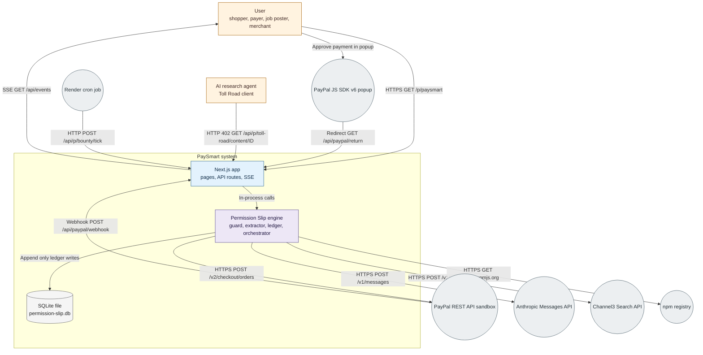
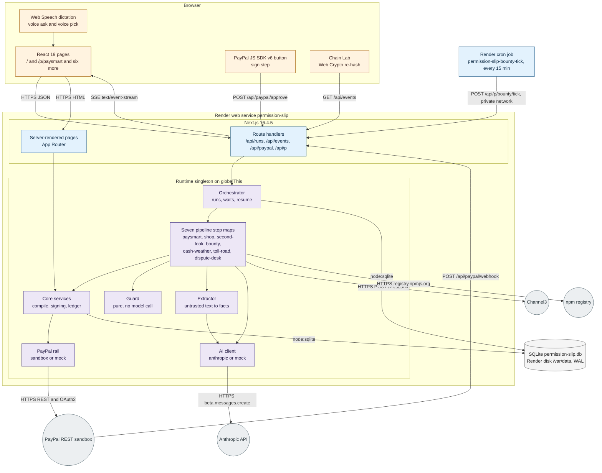
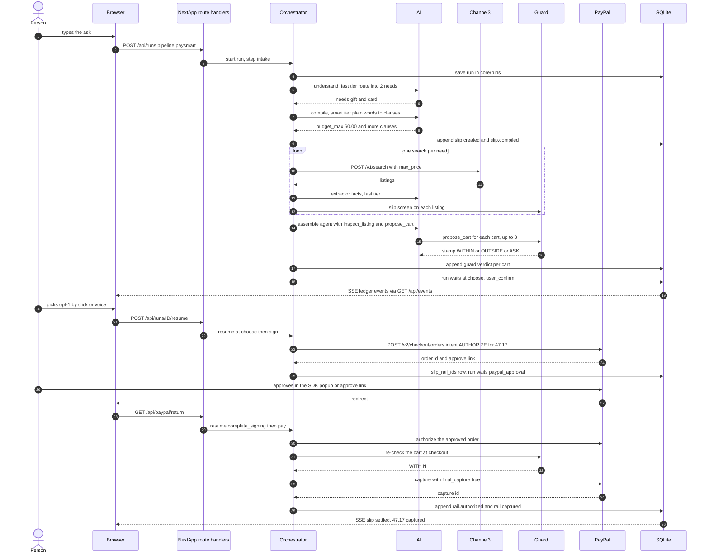
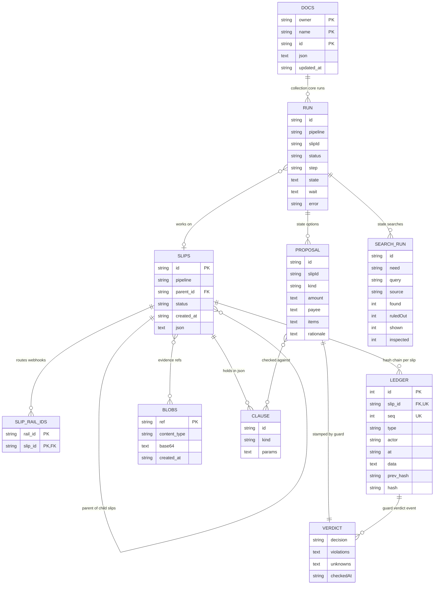
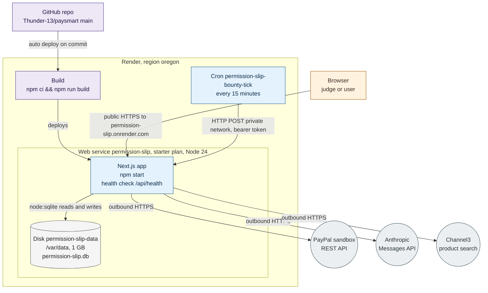

# PaySmart architecture brief

PaySmart is a Next.js app that lets an AI agent shop and pay under a signed, machine-checked mandate, built for the PayPal AI Hackathon.

## Table of contents

- [Overview](#overview)
- [Problem definitions and business context](#problem-definitions-and-business-context)
  - [Problem statement](#problem-statement)
  - [Business context](#business-context)
- [C4 system context diagram](#c4-system-context-diagram)
- [System overview](#system-overview)
  - [C4 container diagram](#c4-container-diagram)
  - [C4 container diagram explanation](#c4-container-diagram-explanation)
    - [Request flow sequence](#request-flow-sequence)
  - [Technology stack](#technology-stack)
- [System data models](#system-data-models)
  - [Data model ER diagram](#data-model-er-diagram)
  - [Data model explanation](#data-model-explanation)
- [API endpoints](#api-endpoints)
  - [Core API routes](#core-api-routes)
- [Deployment architecture](#deployment-architecture)
  - [Render blueprint](#render-blueprint)
  - [Runtime modes](#runtime-modes)
  - [Scaling at 10x](#scaling-at-10x)
- [Document metadata](#document-metadata)

## Overview

PaySmart is the front door. A person types or dictates what they need in plain words, for example "a dinosaur gift and a birthday card, under $60". PaySmart searches, screens every listing, lets an agent build up to 3 carts, and shows a guard verdict on each. The person picks one cart, signs with PayPal, and PayPal holds exactly that cart's total. Asks that are not shopping go to the pipeline built for them, with no slip and no PayPal call. The same app also serves people paying a stranger, small-job posters and workers, small businesses watching cash flow, publishers and research agents, and merchants facing disputes.

Permission Slip is the engine inside. PaySmart is the product and the brand on screen. Permission Slip names the mechanism: a signed slip with numbered clauses (c1, c2, ...), a deterministic guard, and a hash-chained ledger with one chain per slip. Internal ids keep the engine's name on purpose: the npm package is `permission-slip`, the database file is `permission-slip.db`, and the Render services are `permission-slip` and `permission-slip-bounty-tick`. The guard is a pure function that calls no model, so text inside a listing cannot argue with it.

One orchestrator runs seven pipelines, each with a page at `/p/<id>`:

- `paysmart`: the plain-words front door that routes, searches, screens, builds carts and pays.
- `shop`: Permission Slip shopping with a voice add-on, hired helpers on child slips, and a delivery photo refund.
- `second-look`: a scam interceptor that swaps a Friends and Family send to a stranger for a protected payment.
- `bounty`: photo-verified payouts for small jobs, with a deadline sweep.
- `cash-weather`: a 13-week cash-flow forecast, invoice reminders, and payouts to npm maintainers.
- `toll-road`: HTTP 402 pay-per-fetch for research agents, settled in bulk on PayPal Payouts.
- `dispute-desk`: dispute answers drafted from evidence recorded when the money moved.

Mock mode is the default everywhere. With no keys set, a stateful in-memory mock of the PayPal REST API and a scripted AI run every pipeline end to end, offline. Sandbox PayPal and the Anthropic API switch on only when both the mode variable and the credentials exist.

## Problem definitions and business context

### Problem statement

An agent that shops for you needs a way to pay, and that usually means it holds your card or a spending token. Whatever it reads along the way can try to steer it. A hidden instruction in a product listing, a seller chat, or a web page is enough to push an agent toward a bigger cart, a different payee, or a payment method with no buyer protection. `docs/IDEATION.md` cites three reported cases: OpenAI's Operator bought eggs on a saved card without approval (Feb 2025), a hidden instruction in a Reddit post hijacked Perplexity's Comet browser agent (Aug 2025), and a Microsoft Research marketplace simulation found agents open to manipulation, including prompt injection (Nov 2025).

The usual safeguards sit inside the model's own context. An approval prompt, a budget cap written into the system prompt, or a rule the agent is asked to follow is text the agent reads next to the attacker's text. Both compete for the same attention, so a well-placed paragraph can talk past either one. The same source cites survey figures on the trust gap: in a Visa Trust Index survey (May 2026), 23% of US adults would trust generative AI to execute a payment.

What people need is a written mandate that money cannot exceed. They state it in plain words, they can read the numbered clauses it becomes, and the limit is enforced outside the model, at the payment rail and in code the agent cannot talk to. Whatever is not spent returns to them, and every decision can be checked afterward.

Existing options fall short in specific ways, according to the comparison in `docs/IDEATION.md`:

- Google's AP2 defines intent and cart mandates as a protocol, which leaves the consumer product to others.
- Visa Intelligent Commerce and Mastercard Agent Pay put limits in network tokens that issuers control, so the person does not write or read the mandate.
- Payman and Skyfire are developer tools.
- Stripe's Shared Payment Token scopes one seller and a maximum amount inside ChatGPT checkout.
- PayPal's own agentic services (Agent Ready and Store Sync) serve merchants. The shopper's side had no product on PayPal.

PaySmart fills that gap on PayPal rails: the cap is a real PayPal authorization, the mandate is readable, and the guard never reads text the agent can be fed.

### Business context

- **Primary users**
  - People asking an agent to buy something. This is the PaySmart front door and the Shop pipeline.
  - Shoppers who want a gift, a card, or similar goods under a stated budget (`paysmart`, `shop`).
  - People paying a stranger, such as a marketplace seller who asks for Friends and Family (`second-look`).
  - Small-job posters and the workers who claim the jobs (`bounty`).
  - Small businesses watching cash flow, chasing late invoices, and paying the open-source maintainers they depend on (`cash-weather`).
  - Publishers and research agents that trade articles for per-fetch payments (`toll-road`).
  - Merchants facing PayPal disputes (`dispute-desk`).
- **Use cases**
  - Say what you need, review up to 3 guard-stamped carts, pick one, and pay only that cart's total.
  - Block a hijacked cart: a planted listing pushes a $419.96 cart, and the guard stamps it OUTSIDE with clauses c1, c2, c3 and integrity.
  - Verify a decision after the fact by re-hashing a slip's ledger chain in the browser.
  - Refund a purchase when a delivery photo breaks a clause.
  - Pay a job worker through PayPal Payouts after photo checks pass.
  - Let a research agent fetch articles over HTTP 402 under a small toll slip and settle in one batch.
  - Draft a dispute answer from evidence recorded when the payment was captured.
- **Non-functional requirements**
  - Determinism of the guard: `GuardFn(slip, proposal, {spent, now})` is pure and calls no model. Its one fail-safe exception reads item titles for a multi-pack check that can only raise ASK.
  - Auditability: each slip has its own hash chain, `hash = sha256(prevHash + canonical JSON)`, with identical canonical forms on server and browser.
  - Safe offline demo: mock mode is the default, needs no keys, and the demo seed route returns 404 outside it.
  - Idempotent PayPal calls: every POST carries a `PayPal-Request-Id`, and the webhook handler dedupes events.
  - Single-instance SQLite: one database file on one disk, with WAL mode and a 5000 ms busy timeout. This caps the service at one instance.
  - Accessibility and no-JS fallback: the home ask box is a plain form to `/p/paysmart?ask=...`, and a choice can be made by click, keyboard or voice.
- **Architectural drivers**
  - The hackathon deadline of 2026-11-12 12:00 PST, which favors one codebase and one process.
  - The requirement to use PayPal sandbox meaningfully, which drives the Orders v2 authorize-then-capture flow and Payouts.
  - No third-party PayPal toolkit. `@paypal/agent-toolkit` was removed over transitive advisories, and the app ships its own REST client in `src/core/rail/sandbox.ts`.
  - One deployable unit: a single Next.js Node process with an embedded SQLite file, deployed as one Render web service.
- **Integration points**
  - PayPal REST API sandbox (`https://api-m.sandbox.paypal.com`): OAuth2, Orders v2, Payments v2, Payouts v1, Reporting, Invoicing, Disputes, and webhook signature verification.
  - PayPal JS SDK v6 in the browser, for the approval popup on the sign step.
  - Anthropic Messages API, called through `@anthropic-ai/sdk`.
  - Channel3 search API, `POST https://api.trychannel3.com/v1/search`.
  - npm registry, read by Cash Weather when `CASH_WEATHER_NPM_LIVE` is set.
  - Render cron job, which calls the bounty tick route over Render's private network every 15 minutes.
  - Web Speech API in the browser, for dictating the ask and speaking verdicts.

## C4 system context diagram



Legend: orange is a person or agent client, blue is the Next.js app, purple is the Permission Slip engine, grey is the SQLite store, and slate circles are external systems.

A person uses a browser, which loads pages, follows the ledger over an SSE stream at `/api/events`, and approves payments in PayPal's popup. An AI research agent hits the Toll Road gateway directly and gets an HTTP 402 until it pays. Inside the system boundary, the Next.js app takes every request and hands money decisions to the Permission Slip engine in the same process, so there is one deployable unit and one SQLite file. The engine is the only part that calls outward: PayPal orders over the sandbox REST API, the Anthropic Messages API for routing, compiling, extraction and the cart agent, Channel3 for listings, and the npm registry when Cash Weather's live flag is set. PayPal calls back with signed webhooks, and a Render cron job posts to the bounty tick route every 15 minutes, because cron jobs cannot mount the disk. In mock mode the PayPal, Anthropic and Channel3 circles are replaced by in-process stand-ins, so the demo runs with no keys.

## System overview

### C4 container diagram



Legend: orange is the browser side, blue is the Next.js surface and the cron job, purple is the engine inside the Runtime, grey is storage, slate circles are external systems.

### C4 container diagram explanation

**Browser.** The pages are React 19 and talk to the server over JSON and one SSE stream. The home ask box is a plain form that posts to `/p/paysmart?ask=...`, so it works with scripting off. The PayPal JS SDK v6 button appears on the sign step, with a plain link as fallback. Web Speech handles dictation and voice picks. Chain Lab re-hashes a slip's ledger in the browser with Web Crypto, using the same canonical form as the server (`src/core/store/browser-hash.ts` against `src/core/store/canonical.ts`).

**Render web service.** One Node 24 process runs Next.js 16.4.5. Route handlers live under `src/app/api`. `src/server/runtime.ts` builds the Runtime once from env and caches it on `globalThis` under `__permissionSlipRuntime`. `src/core/runtime-factory.ts` wires the pieces together.

**Runtime parts.**

- **Orchestrator** (`src/core/orchestrator.ts`) runs pipeline step maps. A step returns `next`, `done`, `wait` or `fail`. A run that waits is stored and stops consuming anything until `POST /api/runs/ID/resume` arrives. Wait kinds are `paypal_approval`, `user_confirm`, `user_upload` and `external_event`.
- **Guard** (`src/core/guard.ts`) takes a slip and a proposal and returns `within`, `outside` or `ask`. It is pure and deterministic, does no I/O and calls no model. Its one fail-safe quirk is a multi-pack check on item titles that can only raise `ask`.
- **Extractor** (`src/core/extractor.ts`) is the only door for untrusted text such as listings, chats and dispute messages. It makes a no-tool structured AI call on the fast tier, checks the result with zod, and runs `detectInjection`. Only facts leave. Untrusted text never reaches the guard and never becomes instructions.
- **Core services** (`src/core/services.ts`) compile plain words into clauses, start signing, and append to the ledger.
- **PayPal rail** is chosen at boot. `createSandboxRail` is used only when `PAYPAL_MODE=sandbox` and the client id and secret exist. Otherwise `createMockRail` runs a stateful in-memory copy of the REST API, with an approve page at `/mock-paypal/approve`.
- **AI client** is chosen the same way. `createAnthropicAI` needs `AI_MODE=anthropic` and `ANTHROPIC_API_KEY`. Otherwise `createMockAI` replays scripted choices through the real tools, guard and rail. Every AI call carries a deterministic `mock`.
- **Pipeline step maps**: seven ids, `paysmart` as the front door. Mock mode is the default, so every pipeline runs end to end with no keys.

**SQLite.** One file, `permission-slip.db`, in `DATA_DIR` (`/var/data` on the Render disk, 1 GB). WAL mode, `busy_timeout` 5000. The disk limits the service to one instance and rules out zero-downtime deploys.

**Cron job.** Render cron jobs cannot mount the disk, so `permission-slip-bounty-tick` calls `POST /api/p/bounty/tick` every 15 minutes over the private network with a `CRON_SECRET` bearer.

**External systems.** PayPal REST sandbox (OAuth2 client credentials, Orders v2, Payments v2, Payouts v1, Invoicing v2, Disputes v1, webhooks). Anthropic API for model calls. Channel3 for live product search (`POST https://api.trychannel3.com/v1/search`, with an offline fixture catalog when no key is set). The npm registry for Cash Weather payouts, live only when `CASH_WEATHER_NPM_LIVE` is set.

**Key rules.**

1. Mock or sandbox, mock or Anthropic: decided once at boot from env, never per request.
2. Money moves only after the guard stamps a proposal `within` and the person picks it.
3. Every state change appends a ledger event. `GET /api/events` streams them as SSE, replays a slip's chain when `?slipId=` is set, resumes on `Last-Event-ID`, and sends a heartbeat every 15 seconds.

#### Request flow sequence

The most important flow is the PaySmart demo ask: "a dinosaur gift and a birthday card, under $60", from typed ask to capture.



1. The person types the ask. The browser posts it to `POST /api/runs` for the `paysmart` pipeline, and `intake` starts the run. The run is saved in the docs collection `core/runs`.
2. `understand` routes the ask into needs on the fast tier. Here that is two: a dinosaur gift and a birthday card. Non-shopping asks go to `handoff` instead, with no slip and no PayPal call.
3. `compile` turns the plain words into clauses on the smart tier, such as `budget_max` of 60.00. `screen_request` checks the ask. The slip and its ledger events are written.
4. `discover` runs one deterministic search per need against Channel3 (or the offline fixtures), then the integrity screen, the seller screen and the slip screen. Each search is recorded as a `SearchRun` in `state.searches`.
5. `assemble` hands an agent two tools only: `inspect_listing` and `propose_cart`. It has no search tool. It proposes up to 3 carts.
6. `board` records the guard's stamp for each cart, WITHIN, OUTSIDE or ASK. OUTSIDE carts are shown and cannot be picked.
7. `choose` waits for the person (`user_confirm`). The pick arrives through `POST /api/runs/ID/resume`.
8. `sign` calls Orders v2 with intent AUTHORIZE for exactly the chosen cart total and waits on `paypal_approval`. The browser returns through `GET /api/paypal/return`, which resumes only a run that waits on `paypal_approval`.
9. `complete_signing` authorizes the approved order. `pay` runs the guard once more at checkout (`settlePurchase`), captures with `final_capture`, and releases the remainder of the hold.
10. Each step appends ledger events, and the browser sees them over SSE.

Demo numbers: 2 lanes, `opt-1` at **$47.17** (Clockwork Rex plus the Pop-Up T-Rex card), against a $60 limit. Held is $47.17 and captured is $47.17. After `pay`, the pipeline can continue with `aftercare` (delivery photo), `confirm_refund` and `refund`.

### Technology stack

**Runtime and languages**

- Node.js 24 on Render (`NODE_VERSION` 24). The code needs Node 22.13 or later for the built-in `node:sqlite` `DatabaseSync`.
- TypeScript 5.9.3, `tsx` for scripts.
- Next.js 16.4.5 (App Router, Turbopack).
- React 19.3.0 and react-dom 19.3.0.
- Tailwind CSS 4.3.5.
- zod 4.6.7 for contracts and AI output checks.

**Data storage**

- SQLite through the built-in `node:sqlite` module, one file at `DATA_DIR/permission-slip.db`, WAL mode, `busy_timeout` 5000. Five tables: `slips`, `slip_rail_ids`, `ledger`, `blobs`, `docs`.
- No cache layer. No Redis, no Memcached. Reads go to SQLite.
- No vector store, no embeddings, no RAG.

**Infrastructure**

- Render web service `permission-slip` (node runtime, starter plan, oregon). Build `npm ci && npm run build`, start `npm start`, health check `/api/health`, auto deploy on commit.
- Render disk `permission-slip-data`, 1 GB, mounted at `/var/data`.
- Render cron job `permission-slip-bounty-tick`, every 15 minutes.
- No container image of our own, no reverse proxy of our own, no message queue. Waiting runs are rows in `core/runs`, and the cron job is the only scheduler.

**AI services**

- Anthropic API through `@anthropic-ai/sdk` 1.6.0 (`client.beta.messages.create`, `tool_choice` auto).
- Smart tier, `ANTHROPIC_MODEL_SMART`, default `claude-sonnet-5-5`: slip compile, the PaySmart agent, the delivery photo check.
- Fast tier, `ANTHROPIC_MODEL_FAST`, default `claude-haiku-5-5`: the ask router and the extractor.
- Patterns: structured output through one submit tool checked by zod, a manual tool-use loop for agents, image input for photo checks.
- Mock AI is the default (`AI_MODE=mock`).

**Payments**

- Own PayPal REST client in `src/core/rail/sandbox.ts`, base `https://api-m.sandbox.paypal.com` (override `PAYPAL_API_BASE`). `@paypal/agent-toolkit` was removed because of transitive advisories.
- APIs used: OAuth2 token, Orders v2, Payments v2, Payouts v1, Reporting v1, Invoicing v2, Disputes v1, webhook signature verification. A `PayPal-Request-Id` goes on every POST.
- Browser: PayPal JS SDK v6, public `PAYPAL_CLIENT_ID`.

**Testing and quality**

- Vitest 4.1.12: 784 tests passed in 109 files (checked 2026-11-11).
- ESLint 9, `npm run typecheck`, OpenSpec 1.13.2 (`npm run spec:validate`, 12 changes, strict).
- `npm run redteam`: 11 attack fixtures, all blocked, $0.00 moved. `npm run smoke` and `npm run demo:seed` (7 pipelines, all chains verify).

**Monitoring and security**

- No APM, no metrics backend, no log shipping. Health is checked at `GET /api/health` and Render uses it. SSE streams the ledger, which doubles as the audit trail.
- No user accounts, no login, no RBAC. The demo has a single principal.
- Auth surfaces are four: PayPal OAuth2 client credentials (server to PayPal), webhook signature verification, the `CRON_SECRET` bearer, and the `AFFILIATE_ADMIN_SECRET` bearer (404 when unset).
- The hash-chained ledger is tamper-evident, and the guard sits between agent output and any money movement.

## System data models

### Data model ER diagram



The five tables are real SQL tables created in `src/core/store/sqlite.ts`. `RUN`, `CLAUSE`, `PROPOSAL`, `VERDICT` and `SEARCH_RUN` are logical entities that live as JSON inside `DOCS.json`, `SLIPS.json`, PaySmart run state and ledger event data. They have no tables of their own. The ER diagram tool has no JSON type, so JSON columns show as `text`.

### Data model explanation

**How data flows.** A slip is created from the person's words, so `intent` keeps the verbatim ask. `compile` turns that into clauses (`c1`, `c2`, and so on, drawn from 10 kinds such as `budget_max` and `category_in`) and stores them inside `SLIPS.json`. `discover` records one `SearchRun` per need in the PaySmart run state. `assemble` produces proposals through `propose_cart`, and the guard stamps each with a verdict of `within`, `outside` or `ask`, plus violations and unknowns. Each stamped cart is kept as an option in run state (`proposal`, `verdict`, `rationale`) and also appended to the ledger as a `guard.verdict` event. Signing and capture then write PayPal ids (order, authorization, capture, refund, payout) into `SLIPS.json` under `rail` and into `slip_rail_ids`. Every step adds ledger events along the way.

**JSON in TEXT.** Each table keeps the queryable bits as columns (id, pipeline, parent_id, status, created_at) and the rest as a JSON string in `json`. The contract in `src/core/contracts.ts` is validated by zod at the edges, so adding a field to a slip needs no migration. The cost is that SQL cannot filter on anything inside the JSON. Indexes `slips_pipeline` and `slips_parent` cover the two lookups the app needs. `DOCS` is a schemaless collection store keyed by `(owner, name, id)`.

**The hash chain.** Each ledger row stores `prev_hash` and `hash`. The hash is sha256 of `prev_hash` plus the canonical JSON of the event. The first event of a slip uses the literal `GENESIS` as its `prev_hash`. There is one chain per slip, and `UNIQUE (slip_id, seq)` stops two writers from claiming the same position. The canonical form is shared: `src/core/store/canonical.ts` on the server, `src/core/store/browser-hash.ts` in the browser, and tests compare the two. Chain Lab re-hashes a chain with Web Crypto and marks each row `ok`, `hash-mismatch` or `link-broken`. Event types are namespaced, for example `rail.captured` and `bounty.claimed`.

**Blobs.** Photos and evidence (delivery photos, bounty photos) are stored in `BLOBS` as base64 text with a content type, addressed by `ref`. Slip evidence points at them by ref. `POST /api/blobs` writes and `GET /api/blobs/:ref` reads. Base64 costs about a third more space than raw bytes, which is fine for demo-sized photos on a 1 GB disk.

**Docs collections.** `DOCS` holds ten collections, written as owner/name:

- `core/runs`, `core/webhooks`, `core/affiliate_accounts`, `core/demo-story`
- `paysmart/listings`
- `shop/runs`
- `bounty/bounties`
- `second-look/alerts`, `second-look/handoffs`
- `dispute-desk/cases`

**Money.** Amounts are `{ currency, value }` with `value` a string such as `"47.17"`. The helpers in `@/core/money` do the arithmetic in cents, so there are no floats anywhere, and PayPal's wire format (a string value) maps directly.

**Webhook routing.** PayPal sends order, authorization, capture, refund and payout ids on webhook events. `slip_rail_ids` maps each of those ids to its slip, with `PRIMARY KEY (rail_id, slip_id)` and an index on `slip_id`. `POST /api/paypal/webhook` verifies the signature, records the event in `core/webhooks`, drops duplicates, and looks the slip up through this table.

**No vectors.** There are no embeddings, no vector column and no similarity search. Product search is Channel3's job, and everything the guard decides on is a clause with a number or a list in it.

## API endpoints

### Core API routes

The HTTP surface is 30 route files under `src/app/api`, all on the Node runtime. They expose 35 method and path pairs. Every endpoint below appears once, grouped by what it is for. Dynamic segments are written `:id`. There is no public AI endpoint and there are no user accounts, so most routes are open to whoever can reach the app, which fits a single-principal demo.

**Public API endpoints** (the pages call these)

Runs and slips:

- `GET /api/runs` - list runs, newest first. Optional `?pipeline=` filter; an unknown pipeline id returns 400. (user-facing)
- `POST /api/runs` - start a run with `{pipeline, input}`. Returns 202 with the run snapshot and keeps working in the background. (user-facing)
- `GET /api/runs/:id` - one run with its slip and that slip's ledger events. 404 for an unknown run. (user-facing)
- `POST /api/runs/:id/resume` - send a `{signal}` to a waiting run (a cart choice, a confirmation, an upload). Returns 202; 409 when the run is not waiting. (user-facing)
- `GET /api/slips` - list slips, newest first, with the same `?pipeline=` filter. (user-facing)
- `GET /api/slips/:id` - a slip with its events, child slips and a ledger chain verification result. 404 when missing. (user-facing)
- `GET /api/slips/:id/evidence` - the evidence pack for a slip. `?download=1` adds a `Content-Disposition` header so the browser saves a JSON file. (user-facing)

Live updates and files:

- `GET /api/events` - Server-Sent Events stream of ledger events. With `?slipId=` it replays that slip's chain, then streams live, and honors `Last-Event-ID` on reconnect. Without `slipId` it replays the 50 latest events. A 15 second heartbeat keeps the connection open. (user-facing)
- `POST /api/blobs` - store a photo or JSON file from `{contentType, base64}`. Allowed types are PNG, JPEG, WebP, GIF and JSON; 415 for any other type, 413 above 2 MB decoded. Returns 201 with a ref. (user-facing)
- `GET /api/blobs/:ref` - the stored bytes with their content type, immutable cache headers and `nosniff`. 404 when the ref is unknown. (user-facing)
- `GET /api/health` - returns the active `paypal` and `ai` modes and the package version. Render uses it as the health check. (user-facing)

Pipeline routes under `/api/p/`:

- `GET /api/p/bounty` - the bounty board: each bounty with its pool slip, pledge slips, funding and run state. (user-facing)
- `GET /api/p/shop/children` - helper child slips carved from a shop slip, oldest first. Needs `?slipId=`; 400 without it. (user-facing)
- `GET /api/p/shop/photo` - a stored delivery photo by `?ref=`, image types only. 404 when missing. (user-facing)
- `GET /api/p/dispute-desk/disputes` - the dispute deadline board: lanes by status, urgency, links and cases. (user-facing)

**Internal API endpoints**

- `POST /api/p/bounty/tick` - the bounty deadline sweep. It closes bounties past their deadline so PayPal voids the pledge holds, and returns `{resumed, closed, at}`. Called by the Render cron job every 15 minutes. Needs the `CRON_SECRET` bearer; 404 while the secret is unset, 401 on a wrong token. (system-internal)
- `POST /api/demo/seed` - runs the seven-pipeline demo story once through the real orchestrator. Idempotent: a second call reports `already_loaded` and adds nothing. It answers 404 unless the PayPal rail is the mock rail, and 409 if the AI is not the scripted mock. The home page button "Load the demo story" calls it. (system-internal)
- `POST /api/p/dispute-desk/seed` - seeds mock disputes from `{links: [{captureId, scenario}]}`. Mock mode only; 409 in sandbox. (system-internal)

**PayPal integration**

- `GET /api/paypal/return` - where PayPal sends the buyer after approval (`?slipId=&token=`). It resumes the run only if that run is waiting on `paypal_approval`, then redirects with 303 to the slip's `meta.returnPath` with `run=ID` appended. A stale link lands on the run's current state. (user-facing)
- `GET /api/paypal/cancel` - the buyer backed out. It marks the slip `rejected` (only from `draft` or `awaiting_signature`), resumes the waiting run with `approved: false`, and redirects the same way. (user-facing)
- `POST /api/paypal/approve` - called by the PayPal JS SDK v6 button's `onApprove` with `{orderId}`. It finds the slip that owns the order and resumes its run. 404 when no slip owns the order, 409 when no run waits on approval or the run was already resumed. A forged call cannot create a hold, because `authorizeOrder` only succeeds on an order PayPal itself approved. (user-facing)
- `GET /api/paypal/sdk-config` - tells the browser whether the SDK button can run. It returns `{available: false}` in mock mode, and `{available: true, sdkUrl, clientId}` in sandbox mode. Only the public client id is exposed, never the secret or an access token. Responses are `no-store`. (user-facing)
- `POST /api/paypal/webhook` - receives PayPal events. It reads the raw body, asks PayPal to verify the signature, and answers 400 if verification fails or the body is not JSON. A verified event is deduplicated by event id in `core/webhooks`, matched to a slip through `slip_rail_ids`, and appended to the ledger as `webhook.received`. Refunds, voided authorizations and new disputes also move the slip status (`src/server/webhook.ts`). (system-internal)

**Authentication and access control**

PaySmart has no user accounts, no login and no sessions. It is a single-principal demo, and the slip's `principal` is a name and email, not a credential. The access controls that do exist:

- PayPal OAuth2 client credentials, server to PayPal only. The client id and secret fetch a cached access token for every REST call. The browser never sees them.
- Webhook signature verification. `POST /api/paypal/webhook` rejects any event PayPal's verify endpoint does not confirm.
- `CRON_SECRET` bearer on the bounty tick, compared in constant time. The route does not exist (404) until the secret is set.
- `AFFILIATE_ADMIN_SECRET` bearer on the owner-only affiliate routes below. 404 while the secret is unset, 401 with a `WWW-Authenticate: Bearer` challenge on a missing or wrong token. Both sides are hashed before a constant-time compare (`src/server/admin-auth.ts`).
- Mock-only gates on the two seed routes, so the sandbox rail cannot be pushed through a scripted story.

The affiliate routes:

- `GET /api/affiliates` - list affiliate accounts and the network presets. (system-internal)
- `POST /api/affiliates` - create an account. 201 with the account, 400 with issues on bad input. (system-internal)
- `PATCH /api/affiliates/:id` - update an account. 404 for an unknown id, 400 on bad input. (system-internal)
- `DELETE /api/affiliates/:id` - remove an account. 404 for an unknown id. (system-internal)
- `POST /api/affiliates/preview` - send `{url}` and get back the URL plus the affiliate link, or `null` when no active account matches. (system-internal)

**AI/ML integration**

No endpoint calls a model on behalf of the browser. AI runs server-side inside pipeline steps, through `Runtime.ai`, and the routes above only start or resume runs. Each call has a deterministic mock, so every pipeline also runs with no key.

| Call site | Tier | Default model | Location |
| --- | --- | --- | --- |
| compile-slip (plain words to clauses) | smart | claude-sonnet-5-5 | `src/core/services.ts:236` |
| paysmart.agent (assembles up to 3 carts) | smart | claude-sonnet-5-5 | `steps.ts:378` |
| paysmart.delivery_check (photo image check) | smart | claude-sonnet-5-5 | `steps.ts:633` |
| paysmart.route (split the ask into needs) | fast | claude-haiku-5-5 | `steps.ts:270` |
| extractor (untrusted text to facts) | fast | claude-haiku-5-5 | `src/core/extractor.ts:73` |

Other pipeline agents use the smart tier. The model ids come from `ANTHROPIC_MODEL_SMART` and `ANTHROPIC_MODEL_FAST`. There are no embeddings, no vector store and no retrieval.

**Data processing**

- `GET /api/p/toll-road/content` - the public price list. Each entry links to its toll booth URL. (user-facing)
- `POST /api/p/toll-road/content` - register an article behind the booth with `{publisher: {name, email}, title, body, price}`. 400 with field errors on bad input, 201 on success. (user-facing)
- `GET /api/p/toll-road/content/:id` - the toll booth. Without the `x-permission-slip` header it answers HTTP 402 with a price quote and a `WWW-Authenticate: PermissionSlip` challenge for the toll road. With an active toll slip it meters the fetch against the slip and returns the article. Metered fetches are settled in bulk through PayPal Payouts. (user-facing)
- `GET /api/p/cash-weather/sample-input` - the Cash Weather fixture input (package.json, import counts, balance, buffer, monthly cap, seed, principal), ready to POST to `/api/runs` as `{pipeline: "cash-weather", input}`. Demo scripts use it to start a run without importing pipeline code. (user-facing)
- `GET /api/p/second-look/alerts` - family alerts for a trusted contact, newest first. Needs `?to=<email>`; 400 without it. (user-facing)
- `GET /api/p/second-look/handoff` - the hand-off record for a run, from `?runId=`. 400 without it, 404 when none exists. (user-facing)
- `POST /api/p/second-look/handoff` - file "item never arrived" for a Second Look run with a captured payment, from `{runId}`. Idempotent per capture: 201 the first time, 200 after. 404 for an unknown run, 409 when the run has no capture. (user-facing)

**Outbound PayPal REST calls**

All of them live in `src/core/rail/sandbox.ts`. Every POST carries a `PayPal-Request-Id` header (line 201), and free text is clipped to 127 characters at word boundaries (`src/core/rail/clip.ts`).

| API | Method and path | Line |
| --- | --- | --- |
| OAuth2 token (cached) | POST /v1/oauth2/token | 166 |
| Orders v2 | create order | 257 |
| Orders v2 | get order | 268 |
| Orders v2 | authorize order | 279 |
| Orders v2 | capture order | 286 |
| Orders v2 | add tracking | 362 |
| Payments v2 | capture authorization | 297 |
| Payments v2 | void authorization | 307 |
| Payments v2 | reauthorize | 313 |
| Payments v2 | refund capture | 324 |
| Payouts v1 | create batch | 339 |
| Payouts v1 | get batch | 345 |
| Reporting v1 | GET /v1/reporting/transactions | 379 |
| Invoicing v2 | list invoices | 392 |
| Invoicing v2 | send reminder | 397 |
| Disputes v1 | list disputes | 404 |
| Disputes v1 | show dispute | 409 |
| Disputes v1 | provide evidence | 428 |
| Disputes v1 | accept claim | 433 |
| Webhooks | POST /v1/notifications/verify-webhook-signature | 450 |

## Deployment architecture

### Render blueprint

`render.yaml` defines the whole deployment: one web service, one persistent disk and one cron job. Pushing to `main` on the GitHub repo redeploys the web service (`autoDeployTrigger: commit`).



Legend: orange is the person using the app, blue is the running Render services, purple is the build and source pipeline, grey is storage, blue-grey is external systems.

What the diagram shows:

- **Source and build.** GitHub repo `Thunder-13/paysmart` on `main` triggers a build on every commit. The build command is `npm ci && npm run build`, and the start command is `npm start`.
- **Web service `permission-slip`.** Runtime node, plan `starter`, region `oregon`, `NODE_VERSION` 24. Render polls `/api/health` before sending traffic. Public traffic arrives over HTTPS at `permission-slip.onrender.com`.
- **Disk `permission-slip-data`.** 1 GB mounted at `/var/data`, with `DATA_DIR=/var/data`. The SQLite file `permission-slip.db` lives there (WAL mode), so slips, ledger chains, runs and blobs survive a restart.
- **Cron `permission-slip-bounty-tick`.** Schedule `*/15 * * * *`. Its start command is a short `node -e` script that POSTs to `http://WEB_HOSTPORT/api/p/bounty/tick` on the web service over Render's private network, with `CRON_SECRET` as a bearer token. Both values come from the web service through `fromService`.
- **Outbound calls.** The web service reaches the PayPal sandbox (`api-m.sandbox.paypal.com`), Anthropic and Channel3 over HTTPS. Each one is used only when its mode and key are set (see the next section).

**Why the cron job uses HTTP.** A Render disk attaches to one service only, and a cron job cannot mount it. A cron process therefore cannot open the SQLite file. It calls the web service, which owns the file, and the route does the sweep (`src/server/cron.ts`).

**One instance, no zero-downtime deploys.** The same disk rule means the web service runs a single instance. Render stops the old instance before it starts the new one, so each deploy has a short gap. A persistent disk also needs a paid plan, which is why the blueprint uses `starter`.

### Runtime modes

Mock is the default for both switches. A mode is only live when its keys exist, and a mode set without keys falls back to mock (`src/server/config.ts`). In particular, `PAYPAL_MODE=sandbox` without both `PAYPAL_CLIENT_ID` and `PAYPAL_CLIENT_SECRET` resolves to mock, and `AI_MODE=anthropic` without `ANTHROPIC_API_KEY` resolves to mock. If a mode is unset, the keys decide: with keys present it goes live, without them it stays mock.

| PAYPAL_MODE | AI_MODE | Needs | Result |
| --- | --- | --- | --- |
| mock | mock | Nothing | Default. In-memory mock PayPal rail and scripted AI. Every pipeline runs offline. The demo seed works. |
| sandbox | mock | `PAYPAL_CLIENT_ID`, `PAYPAL_CLIENT_SECRET`, ideally `PAYPAL_WEBHOOK_ID` | Real PayPal sandbox orders, holds, captures and payouts, with scripted AI. |
| mock | anthropic | `ANTHROPIC_API_KEY` | Real Claude calls against the mock rail. |
| sandbox | anthropic | Both sets of keys | Fully live path. Add `CHANNEL3_API_KEY` for live product search; without it the offline fixture catalog answers. |
| sandbox, keys missing | any | None of the above | Falls back to mock for the missing side. |

`POST /api/demo/seed` only works on the mock rail with the scripted AI, so the hosted demo stays at mock and judges press "Load the demo story".

Environment variables, grouped:

- **Required for live PayPal and AI:** `PAYPAL_MODE`, `PAYPAL_CLIENT_ID`, `PAYPAL_CLIENT_SECRET`, `PAYPAL_WEBHOOK_ID` (webhook verification), `AI_MODE`, `ANTHROPIC_API_KEY`.
- **Optional:** `ANTHROPIC_MODEL_SMART` (default claude-sonnet-5-5), `ANTHROPIC_MODEL_FAST` (default claude-haiku-5-5), `CHANNEL3_API_KEY`, `APP_BASE_URL` (falls back to `RENDER_EXTERNAL_URL`, then `http://localhost:3000`), `DATA_DIR` (default `./data`), `CRON_SECRET` (turns the bounty tick on), `AFFILIATE_ADMIN_SECRET` (turns the affiliate routes on), `TOLL_ROAD_MOCK_DELAY_MS` (animation delay in mock mode, default 400).
- **Sandbox-only accounts and overrides:** `SECOND_LOOK_SELLER_EMAIL`, `SHOP_HELPER_EMAIL`, `CASH_WEATHER_RECEIVERS_JSON`, `TOLL_ROAD_PUBLISHER_EMAILS`, `CASH_WEATHER_NPM_LIVE`, `PAYPAL_API_BASE`.

Run it locally (Node 22.13 or newer, because of `node:sqlite`):

```bash
npm ci
cp .env.example .env.local
npm run dev
npm run demo:seed
```

Quality gates, verified on 2026-11-11:

- `npm test`: 784 tests passed in 109 files.
- `npm run typecheck`, `npm run lint`.
- `npm run spec:validate`: 12 OpenSpec changes, `--strict`.
- `npm run redteam`: 11 attack fixtures, all blocked, $0.00 moved.
- `npm run smoke`: end-to-end scripts for the pipelines.
- `npm run demo:seed`: 7 pipelines, every ledger chain verifies.

Known gaps: the PayPal popup approval with a sandbox buyer is not exercised end to end, and a live Channel3 two-need ask is untested (fixtures only).

### Scaling at 10x

Everything in this section is a proposal. None of it is built.

| Component | What breaks first at 10x | Proposed path |
| --- | --- | --- |
| SQLite on one disk | One file on one disk means one instance, so no horizontal scale and a gap on every deploy. | Move to Postgres, or Turso/libSQL if the SQLite API is worth keeping. The `Store` interface in `src/core/contracts.ts` is the seam. |
| Runs in the web process | Pipeline steps run in the request process through `after()`. Heavy load competes with page traffic. | Put run execution on a queue with separate workers. |
| SSE fan-out | `ledger.subscribe` is an in-process EventEmitter. A second instance would not see the first one's events. | Redis pub/sub (or Postgres LISTEN/NOTIFY) between instances. |
| Mock rail | Mock disputes and orders sit in memory and reset on restart. This only affects mock mode. | Persist mock rail state in the store if the demo needs to survive restarts. |
| PayPal API | Sandbox and live accounts have rate limits, and every capture or payout is a network round trip. | Back off on 429 responses, batch payouts (Toll Road already settles in bulk), and keep `PayPal-Request-Id` for safe retries. |
| Anthropic API | Rate limits and latency bound how many runs can assemble carts at once. | Queue the AI steps, cap concurrency per tier, and keep the fast tier for routing and extraction. |
| Channel3 search | Live search latency adds to each need, and the first run is one search per need. | Cache results per query, and run the per-need searches in parallel. |

## Document metadata

| Field | Value |
| --- | --- |
| Document | PaySmart architecture brief |
| Repository | https://github.com/Thunder-13/paysmart |
| Author | Thunder-13 |
| Version | 1.0 |
| Date | 2026-11-11 |
| Source of truth | Code at the commit this file ships in |
| Related docs | README.md, PRODUCT.md, DESIGN.md, docs/STAGES.md, docs/CONVENTIONS.md, openspec/ |

